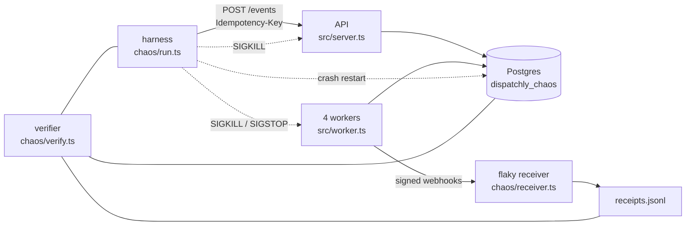

# Chaos harness and verifier

Last updated: 2026-10-19

## What it proves

The reliability design promises one sentence: once `POST /events` returns 2xx,
every delivery of that event ends `delivered` or `dead`, never missing. The
harness tries hard to break that sentence and the verifier checks whether it
held.

    docker compose up -d
    npm run chaos

One run takes about a minute on a laptop. It prints a summary like the one
below, writes it to `chaos/out/<run>/summary.md`, and exits 1 if anything was
lost.

## How it works

Everything is the real code: the API and workers run as separate OS processes
started from `src/`, so a `kill -9` is a real crash, not a simulated one. The
harness creates a fresh `<db>_chaos` database (the dev database is never
touched), registers three endpoints through the API, then ingests 1,000 events
at 40 per second while faults fire. When ingest ends, faults continue for 10 s
so the retry backlog gets hit too. Then the harness lets the queue drain, stops
everything and runs the verifier.

Workers use the "demo" column of the retry table in the reliability design:
base 1 s, cap 10 s, 6 attempts, 2 s timeout, 5 s lease. That makes a full
retry-to-dead cycle take seconds instead of hours, without changing any code
path.

### Faults

| Fault | How | What it attacks |
| --- | --- | --- |
| Worker crash | `SIGKILL` a random worker every ~1.5 s, restart it 0.1 to 1 s later | Leases: an abandoned claim must be re-claimed, never forgotten |
| Fleet crash | 10% of worker faults kill every worker at once | Nothing in memory can matter, because no process survives |
| Stalled worker | `SIGSTOP` a worker for longer than its lease, then `SIGCONT` | Fencing: another worker re-claims the row, and the stale worker's late result must be dropped by `claim_token` |
| API crash | `SIGKILL` the API every ~12 s during ingest | Ingest: a client that sees a dropped connection retries with the same `Idempotency-Key` |
| Database crash | Kill Postgres every ~15 s (`docker compose kill db && docker compose start db`) | Every process loses its connections mid-query; Postgres replays its WAL on restart |
| Receiver 500 | 15 to 25% of requests on the flaky endpoints | Retries with backoff |
| Receiver hang | 2%: never answered | The request timeout |
| Connection drop | 3 to 5%: socket destroyed before processing | Network errors count as failures |
| Lost 200 | 5 to 10%: processed, then socket destroyed before the response | The reason exactly-once is impossible; must cause a duplicate, never a loss |
| Dead endpoint | A third endpoint answers 500 to everything | Dead-lettering at scale: all 1,000 must end `dead`, none stuck |

Random choices come from a seeded generator (`CHAOS_SEED`, printed at the
start), so a failing run's fault sequence can be repeated. Timing still varies,
so a rerun is similar rather than identical.

### The verifier

It compares three independent records:

1. **What clients were told.** The harness keeps every `event_id` that came
   back with a 2xx. An event whose every attempt failed is not "accepted" and
   is not covered by the guarantee (none have, so far).
2. **What the database says.** `events` and `deliveries` after the drain.
3. **What the receiver got.** The receiver appends a JSON line for every
   request with a synchronous write *before* it responds, so a 200 can never
   reach a worker without a line already being on disk. Each line records the
   `webhook-id` (the event id) and what the receiver did.

A run passes only if all of these hold:

- Every accepted event is in `events`, with one delivery row per endpoint.
- Every delivery row is `delivered` or `dead`. Nothing is left `pending`.
- Every `delivered` row has at least one "processed" line in the receiver log.
  This is the check that catches a lost event: the database saying delivered
  when the receiver never got it.
- Every `dead` row used all 6 attempts.
- Every signature the receiver checked was valid.
- Every repeated `Idempotency-Key` returned the same event.

Duplicates are counted, not failed, because delivery is at-least-once by
design. The summary splits them into duplicates after a lost 200 (injected on
purpose, so their number mostly reflects the receiver's settings) and
duplicates Dispatchly caused itself after a crash, a pause or a result write
that failed while Postgres was down.

### Making sure the verifier can fail

A verifier that has only ever said PASS proves nothing. Two checks:

- `test/chaos-verify.test.ts` feeds it hand-built runs with one thing broken
  each (a missing receipt, a skipped fan-out, a stuck row, an early dead
  letter, a bad signature) and asserts it names the right violation.
- A sabotaged worker. Changing `send()` so a reset connection counts as
  success, a plausible bug, made a 300-event run end
  `FAIL: 26 of 900 deliveries missing`, each one listed as
  `delivered_not_received`, with exit code 1.

## Results

Five runs with the default settings and one larger run, all with Postgres
crash-restarts on. These ran in a Linux container (4 CPUs, Node 22,
Postgres 16), not on the MacBook; numbers on the Mac will differ a little.

| Seed | Events | Deliveries | Delivered | Dead | Missing | Duplicates (Dispatchly-caused) | Worker kills / pauses | Stale writes fenced | API kills | DB restarts | Time |
| --- | --- | --- | --- | --- | --- | --- | --- | --- | --- | --- | --- |
| 42 | 1,000 | 3,000 | 1,995 | 1,005 | **0** | 262 (38) | 43 / 3 | 1 | 2 | 2 | 63 s |
| 101 | 1,000 | 3,000 | 1,997 | 1,003 | **0** | 230 (9) | 25 / 3 | 1 | 2 | 2 | 62 s |
| 202 | 1,000 | 3,000 | 1,997 | 1,003 | **0** | 260 (10) | 23 / 2 | 0 | 2 | 2 | 60 s |
| 303 | 1,000 | 3,000 | 1,994 | 1,006 | **0** | 230 (28) | 21 / 3 | 1 | 3 | 2 | 60 s |
| 7 | 1,000 | 3,000 | 1,998 | 1,002 | **0** | 223 (8) | 27 / 4 | 3 | 3 | 1 | 59 s |
| 2026 | 5,000 | 15,000 | 9,982 | 5,018 | **0** | 1,154 (69) | 80 / 8 | 0 | 8 | 7 | 198 s |

The last row is `CHAOS_EVENTS=5000 CHAOS_EVENTS_PER_SEC=50`. No worker
exited on its own in any run, and no signature check failed.

About 1,000 of the dead letters in each run are the always-500 endpoint, by
design. The rest are flaky-endpoint deliveries that failed six times in a row.

A quotable line, from seed 101:

> Under 25 worker `kill -9`s, 2 API kills, 2 Postgres crash-restarts and a
> receiver that failed a third of requests on two endpoints and all of them
> on a third, all 3,000 deliveries ended delivered (1,997, each confirmed in
> the receiver's log) or dead-lettered (1,003), with 0 missing. 9 deliveries
> (0.45%) reached the receiver twice because of a Dispatchly-side crash, every
> copy with the same `webhook-id`.

## What it found

- **One slow receiver stalls a whole batch.** `tick()` claims up to
  `WORKER_CONCURRENCY` rows and waits for all of them with `Promise.all`, so a
  single hanging request holds 49 finished slots idle until its timeout. Under
  chaos the queue backs up for this reason, not because of Postgres. In
  production, with a 10 s timeout, one slow customer endpoint would delay
  everyone's webhooks. The fix is a worker that keeps N requests in flight and
  claims a new row each time one finishes. That is a separate change; the
  harness only measures it.
- **The fence is hard to hit, and that is fine.** A stale write needs a worker
  paused mid-request, its lease to run out, and another worker to re-claim the
  row before it wakes. With fast responses most pauses catch nothing in
  flight, so the harness adds 0 to 200 ms of receiver latency and pauses one
  worker at a time. Even so, runs fence 0 to 3 stale writes. The summary
  reports the count, so a run that never exercised the fence is visible. The deterministic proof stays the SIGSTOP
  test in `test/worker.test.ts`.
- **The ingest crash window is tiny.** An API that commits an event and dies
  before answering forces the client's retry to return the stored event (200).
  The harness counts these in `results.json` (`retry_found_existing`) and has
  not hit one yet: the window is microseconds. `scripts/check-events.sh` and
  the idempotency spot checks cover the same code path directly.

## Limits

These are worth saying out loud in an interview, before someone else does.

- **One machine, loopback network.** No real network latency, packet loss or
  partitions. A database restart is the closest thing to a partition between
  workers and Postgres.
- **It trusts Postgres durability.** Killing Postgres tests crash recovery
  with `fsync` on. It does not test a lost disk or a misconfigured
  `synchronous_commit`.
- **The receiver is the harness's own.** Its log is the ground truth, so a bug
  in the receiver could hide a loss. That is why it writes the line
  synchronously before responding, and why the unit tests check the verifier
  against hand-built logs.
- **It doesn't dedupe.** A real receiver should drop repeats on `webhook-id`
  (`examples/receiver.ts` does). The harness counts them instead, to measure
  the duplicate rate.
- **Statistical, not exhaustive.** Random faults find races that happen
  often. A race that needs a one-in-a-million interleaving needs a model
  checker or a targeted test, like the SIGSTOP fencing test in
  `test/worker.test.ts`.

## Settings

All optional.

| Variable | Default | Meaning |
| --- | --- | --- |
| `CHAOS_EVENTS` | 1000 | Events to ingest (each fans out to 3 endpoints) |
| `CHAOS_EVENTS_PER_SEC` | 40 | Ingest rate |
| `CHAOS_WORKERS` | 4 | Worker processes |
| `CHAOS_SEED` | random | Seed for fault and receiver choices |
| `CHAOS_WORKER_FAULT_EVERY_MS` | 1500 | Average gap between worker faults |
| `CHAOS_API_KILL_EVERY_MS` | 12000 | Average gap between API kills; 0 turns them off |
| `CHAOS_DB_RESTART_EVERY_MS` | 15000 | Average gap between Postgres restarts; 0 turns them off |
| `CHAOS_DB_RESTART_CMD` | `docker compose kill db && docker compose start db` | How to crash-restart Postgres; `off` disables. Without Docker Compose running, restarts are skipped and the summary says so |
| `CHAOS_TAIL_MS` | 10000 | How long faults continue after ingest ends |
| `CHAOS_DRAIN_TIMEOUT_MS` | 240000 | How long to wait for the queue to empty |
| `CHAOS_API_PORT` | 3100 | Port for the harness's API process |

The Postgres restart kills the whole dev container, so anything else using it
(like `npm run dev`) sees the same outage.

## Explaining it in an interview

"How do you know you don't lose events?" Short version:

1. Define lost precisely: the client got a 2xx, and the event never reached
   the receiver and was never dead-lettered.
2. Get three records that don't depend on each other: what clients were told,
   what the database says, and what the receiver wrote to disk before it
   answered.
3. Break things for real: `kill -9` the processes and Postgres, not mocks.
4. Check every single event, not a sample, and report duplicates instead of
   hiding them, because at-least-once means they are expected.
5. Show the checker can fail: inject a bug and watch it go red.
