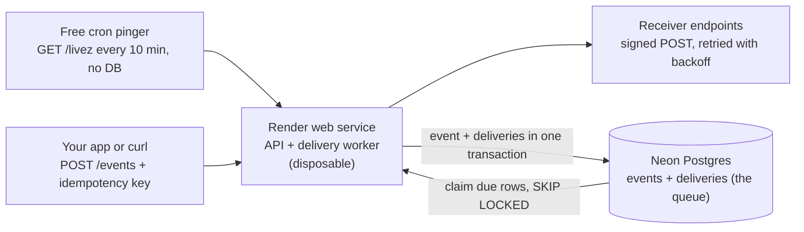

# Deploy stack (free tier)

Decided 2026-10-19. Provider limits were checked on that date and change often.

## Decision

Dispatchly runs as **one Node process (API + delivery worker) on a Render free
web service, backed by Neon free Postgres, with Postgres itself as the queue**.
Local development stays on Docker Compose Postgres 16, and CI runs on GitHub
Actions against a Postgres service container.

| Layer | Pick | Free-tier limit to design around |
| --- | --- | --- |
| App host (API + worker) | [Render](https://render.com/docs/free) free web service | Spins down after 15 min with no inbound traffic, ~1 min cold start; 750 instance-hours per month per workspace |
| Database | [Neon](https://neon.com/docs/introduction/plans) Free | 0.5 GB storage, 100 CU-hours/month, 5 GB egress; compute suspends after 5 min with no active queries; hitting a cap suspends the database until next month |
| Queue | The `deliveries` table (`FOR UPDATE SKIP LOCKED` + leases) | Shares Neon's storage and compute budget, so the worker must not poll blindly |
| Keep-warm pinger | A free cron pinger hitting `/livez` every 10 min | Keeps Render awake; `/livez` must not touch Postgres or Neon never sleeps |
| CI | GitHub Actions | Free for public repositories |
| Local dev | `docker-compose.yml` | Neon is pinned to Postgres 16 to match |

Nothing in this stack expires (Render's free Postgres is deleted after 30 days,
and new AWS accounts get a credit-based free plan that ends after 6 months).
Compute is disposable and the data is durable, which is exactly the property
the delivery guarantees rely on.

## How it fits together

A Render restart only pauses deliveries. Rows waiting in Neon stay `pending`,
their leases expire, and the worker picks them up again on boot.

## Options compared

**App hosting**

| Option | Limit that matters | Verdict |
| --- | --- | --- |
| [Render](https://render.com/docs/free) web service | Sleeps after 15 min idle; 750 h/month covers one service 24/7 (744 h in a 31-day month); free tier covers web services, Postgres and Key Value only | **Chosen** |
| [Koyeb](https://www.koyeb.com/docs/run-and-scale/scale-to-zero) Free | One instance, 0.1 vCPU / 512 MB, sleeps after 1 h idle, not allowed for worker services; being acquired by Mistral (Feb 2026) | Fallback |
| [Railway](https://docs.railway.com/pricing/plans) Free | $1 credit/month after a $5 trial; deployments stop when it runs out | Not enough for a 24/7 process |
| [Fly.io](https://fly.io/docs/about/discontinued-plans/) | No free allowance for orgs created after 2024-10-07 | Out |
| [Oracle Cloud Always Free](https://docs.oracle.com/en-us/iaas/Content/FreeTier/resourceref.htm) A1 VM | Needs a card, capacity often unavailable, idle instances can be reclaimed after 7 days | Plan B if Neon's limits are outgrown |
| [AWS](https://aws.amazon.com/about-aws/whats-new/2025/07/aws-free-tier-credits-month-free-plan/) | New accounts: $100 to $200 credits, plan ends after 6 months | Not free long term |

**Postgres**

| Option | Limit that matters | Verdict |
| --- | --- | --- |
| [Neon](https://neon.com/docs/introduction/plans) Free | 0.5 GB, 100 CU-hours/month (about 400 h at 0.25 CU), suspends after 5 min with no active queries, 10 branches/project | **Chosen**: never expires, branches give a throwaway database per experiment |
| [Supabase](https://supabase.com/pricing) Free | 500 MB, 2 projects, pauses after 1 week of inactivity and needs a manual restore | Viable, but a full BaaS that would go unused |
| [Aiven](https://aiven.io/docs/products/postgresql/concepts/pg-free-tier) Free | 1 GB disk, max 20 connections, powered off when it sees no activity | Viable, unclear what counts as activity |
| [Render](https://render.com/docs/free) Free Postgres | 1 GB, deleted 30 days after creation (+14-day grace) | Out |

**Queue**

| Option | Limit that matters | Verdict |
| --- | --- | --- |
| Postgres `deliveries` table | Uses Neon's budget; no extra service | **Chosen** |
| [Upstash Redis](https://upstash.com/pricing) | 500K commands/month; polling once per second alone is ~2.6M/month | Out |
| [Cloudflare Queues](https://developers.cloudflare.com/changelog/2026-02-04-queues-free-plan/) | 10,000 ops/day, 24 h max retention, Workers runtime only | Out: retention is shorter than a multi-day retry schedule |
| [Upstash QStash](https://upstash.com/pricing) | 1,000 messages/day | Out: it is itself a webhook delivery service |
| AWS SQS | 1M requests/month always free, behind an AWS account | Out: account problem, plus the dual write below |

## Why Postgres is the queue

"Zero lost events" needs the event row and its delivery rows committed in one
transaction, and a separate broker breaks that.

- **No dual write.** With Redis or SQS, `POST /events` has to write Postgres
  *and* enqueue. A crash between the two either loses the event or enqueues a
  ghost. The standard fix is a transactional outbox table, and at that point
  the outbox already is the queue.
- **Claiming is solved.** `SELECT ... WHERE status = 'pending' AND
  next_attempt_at <= now() ORDER BY next_attempt_at LIMIT n FOR UPDATE SKIP
  LOCKED` lets several workers take different rows without blocking each other.
  A lease column (`locked_until`) returns a killed worker's rows automatically.
  The `deliveries_due_idx` partial index already supports this query.
- **Retries and the DLQ are columns.** Backoff is `next_attempt_at`, the
  dead-letter queue is `status = 'dead'`, and replay is an `UPDATE`.
- **One fewer free tier.** Every extra service is another limit, account and
  outage.

This stops holding at roughly thousands of sustained deliveries per second, or
when table bloat from constant updates needs serious vacuum tuning.

## Limits and how each is handled

The limit that actually bites is Neon's 100 CU-hours. A worker that polls every
second keeps the database awake all ~730 hours of a month, about 183 CU-hours at
the minimum 0.25 CU, so Neon would suspend it around day 17 (400 awake hours).

| Limit | What breaks if ignored | Handling |
| --- | --- | --- |
| Neon 100 CU-h/month, suspends after 5 min with no queries | Blind polling exhausts the budget mid-month | Idle-aware worker: when nothing is due, sleep until `min(next_attempt_at)`; `POST /events` wakes it in-process; a safety sweep every 30 min. Estimated idle cost is ~30 CU-h/month |
| Neon drops connections when it suspends | node-postgres emits `error` on idle pool clients; with no listener the process crashes | `pool.on('error', ...)` logs it; the pool reconnects on the next query |
| Neon 0.5 GB storage | Database goes over cap and suspends | Retention job deletes delivered rows and their events after 7 days; dead-lettered rows are kept until replayed or purged |
| Render sleeps after 15 min idle | Scheduled retries wait for the next request | Pinger hits `/livez` every 10 min. `/livez` never queries Postgres; `/health` keeps its `SELECT 1` |
| Render ~1 min cold start, restarts at any time | Demo requests time out; in-flight deliveries are interrupted | Nothing is lost: rows stay `pending`, leases expire, the worker sweeps due rows at boot |
| Render's 750 h covers one always-on service | A second free web service suspends both near month end | One Render service; the demo receiver lives on webhook.site or a free Cloudflare Worker |
| One instance in the cloud | Multi-worker `SKIP LOCKED` can't be shown live | Shown in CI and locally with several workers and a kill script |

## Local dev and deploy

Local development is unchanged; the cloud deployment exists for the live demo.

1. **Neon:** create a project on Postgres 16 in AWS US West 2 (Oregon). Use the
   direct (non-pooled) connection string with `sslmode=require`, and load the
   schema once with `psql "$DATABASE_URL" -f db/schema.sql`.
2. **Render:** new Web Service from this repository in the Oregon region (same
   region as Neon, since the worker makes several queries per delivery). Build
   `npm ci && npm run build`, start `npm start`, env `DATABASE_URL` and
   `NODE_VERSION=22`. The server listens on `0.0.0.0:$PORT`.
3. **Pool:** cap `max` at about 5 connections and register `pool.on('error')`.
4. **Pinger:** a free cron pinger (for example cron-job.org) calling
   `GET /livez` every 10 minutes.
5. **CI:** a GitHub Actions workflow with a `postgres:16` service container
   running typecheck and tests.
6. **Schema changes:** Compose only runs `schema.sql` on a fresh volume and Neon
   never re-runs it, so schema changes after the first deploy move to numbered
   migration files applied by a script in both places.

## With a budget

A separate worker service, Neon with scale-to-zero off (or RDS), and several
workers in the cloud. The AWS equivalent would be ECS or Fargate with RDS, and
SQS only if throughput demanded it.

Deliberately left out: Kubernetes or Terraform for a single service, a separate
message broker, multi-region, and splitting API and worker into two deployments
while one free instance is available.
