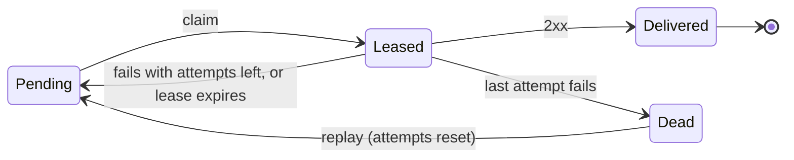

# Dispatchly Reliability Design

Last updated: 2026-10-19

## Summary

Dispatchly promises **at-least-once delivery with a stable event id**, so no accepted event is lost and receivers can drop duplicates. Postgres is the only moving part: the `deliveries` table is the queue, workers claim rows with `FOR UPDATE SKIP LOCKED` and a time lease, failures retry with capped exponential backoff and full jitter, and rows that exhaust retries become `dead` and can be replayed.

The guarantee is scoped on purpose: an event is "accepted" once `POST /events` returns 2xx, and from then on it ends as `delivered` or `dead`, never missing. That sentence is what the chaos harness has to prove.



`Leased` is a pending row whose `next_attempt_at` has been pushed into the future, not its own status. A failed or abandoned attempt always returns the row to `Pending`, so the only exits are `Delivered` and `Dead`.

## Delivery guarantee

**Decision: at-least-once, with dedupe on both edges.** Exactly-once over HTTP is impossible: if the receiver processes a webhook and the connection drops before its 200 reaches us, we cannot tell that apart from a failure, so we must resend. The accurate claim is "at-least-once plus idempotency", never "exactly-once".

Dedupe happens in two places:

1. **Ingestion (client to Dispatchly).** `Idempotency-Key` on `POST /events` is handled in `src/routes/events.ts`. `INSERT ... ON CONFLICT DO NOTHING` plus a follow-up `SELECT` makes 50 concurrent requests with one key produce one event, and `scripts/check-events.sh` proves it. A client that times out can retry safely.
2. **Delivery (Dispatchly to receiver).** Every attempt for an event carries the same `webhook-id` header, set to the event id, per the [Standard Webhooks](https://www.standardwebhooks.com/) spec. Retries and replays reuse it. The receiver stores ids it has processed and drops repeats; the receiver SDK on the roadmap should ship this as a helper.

The event id, not the delivery id, is the right `webhook-id`: one event fanned out to two endpoints is two separate receivers, and each only dedupes its own stream.

Known gaps in ingestion, none blocking:

- A reused key with a **different payload** silently returns the old event. Stripe returns an error in that case. Storing a hash of the request body and returning 422 on mismatch is cheap.
- Keys are global and never expire. Fine with one tenant; scope them per API key once tenants exist.

## Durable queue

**Decision: keep the `deliveries` table as the queue; no Redis, SQS or Kafka.** The event row and its fan-out delivery rows are written in one transaction, so there is no moment where an event exists without its deliveries. That makes `deliveries` a transactional outbox already; a separate `outbox` table would duplicate it.

| Option | Lost-event risk | Free-tier fit | Verdict |
| --- | --- | --- | --- |
| `deliveries` table + SKIP LOCKED | None beyond Postgres durability | One free Postgres | **Chosen** |
| Postgres + Redis/BullMQ | Dual write: commit then enqueue can crash between the two | Second free service to keep alive | Reintroduces the problem an outbox solves |
| Postgres + SQS | Same dual-write gap | AWS free tier, extra IAM and setup | Not worth it at this scale |
| Kafka | Same gap, heavy ops | No realistic free tier | Overengineered |

The tradeoff is throughput. A Postgres queue tops out well below a real broker; the k6 load test will show where, and that measured ceiling is what would justify a broker later.

Free-tier notes, to verify against current provider terms before deploying:

- Serverless Postgres (Neon) scales compute to zero when idle. A worker polling every second keeps it awake and burns the monthly compute allowance, so the poll interval should back off when queues are empty (for example 1s up to 30s).
- Pooled connection strings (PgBouncer in transaction mode) do not support `LISTEN/NOTIFY` reliably. Use polling, and use the direct connection string for the worker.
- Free app hosts that sleep when idle only **delay** deliveries; they cannot lose them, because all state lives in Postgres.

## Worker claiming and crash recovery

**Decision: claim with a short transaction that pushes `next_attempt_at` forward as a lease, then make the HTTP call with no transaction open.** No new `in_flight` status is needed: a claimed row simply is not due until its lease expires. If the worker dies mid-request, the row becomes due again and another worker picks it up.

```sql
-- Claim up to $1 due deliveries. Runs as one autocommit statement.
UPDATE deliveries d
SET attempts        = d.attempts + 1,
    next_attempt_at = now() + interval '60 seconds',  -- the lease
    claim_token     = gen_random_uuid(),              -- fencing token
    updated_at      = now()
WHERE d.id IN (
  SELECT id FROM deliveries
  WHERE status = 'pending' AND next_attempt_at <= now()
  ORDER BY next_attempt_at
  LIMIT $1
  FOR UPDATE SKIP LOCKED
)
RETURNING d.id, d.event_id, d.endpoint_id, d.attempts, d.claim_token;
```

Why not hold the row lock during the HTTP call: a slow receiver would pin a database connection and an open transaction for up to the timeout, and free Postgres plans have small connection limits.

Three rules keep the lease safe:

- **Lease longer than the HTTP timeout.** 10 s request timeout, 60 s lease. Otherwise a slow but healthy request gets claimed twice.
- **Fence the result write on `claim_token`.** Each claim writes a fresh UUID, and the success or failure update includes `WHERE id = $1 AND claim_token = $token`. If a worker stalls past its lease and another worker re-claims the row, the token has changed and the stale write matches zero rows. This is the fencing-token idea from distributed locks. A token is safer than fencing on `attempts`, because replay resets `attempts` and an old count could match again.
- **A crash costs an attempt.** `attempts` counts claims, so a payload that crashes the worker every time still reaches `dead` instead of looping forever.

Every attempt also writes one row to a new `delivery_attempts` table (attempt number, status code, error, duration, first 1 KB of response body), in the same transaction as the result update. The `deliveries` row holds current state; the attempts table is the audit trail that the dashboard, replay and the verifier read.

On `SIGTERM` the worker stops claiming and lets in-flight requests finish. Anything it abandons is recovered by the lease anyway.

## Retry policy

**Decision: capped exponential backoff with full jitter.** After failed attempt *n*, the next attempt is scheduled at:

```math
\text{delay}_n = \text{random}\left(0,\ \min\left(\text{cap},\ \text{base} \cdot 2^{\,n-1}\right)\right)
```

Jitter matters most when a receiver comes back after an outage. Without it, every delivery that failed during the outage retries in the same second and knocks the receiver over again. Full jitter spreads them across the whole window; AWS measured it against other jitter schemes in [Exponential Backoff and Jitter](https://aws.amazon.com/blogs/architecture/exponential-backoff-and-jitter/).

| Setting | Production | Demo / chaos tests |
| --- | --- | --- |
| base | 30 s | 1 s |
| cap | 1 h | 10 s |
| max attempts | 15 | 6 |
| HTTP timeout | 10 s | 2 s |
| Worst-case retry window | about 8 h (about 4 h on average) | about 40 s |

All values come from env vars so the chaos harness can run a full retry-to-dead cycle in under a minute.

What counts as success and failure:

- **Success:** any 2xx. Nothing else.
- **Retry:** every other status, connection errors and timeouts. Stripe and Svix both retry all non-2xx, and it covers the common case of a receiver that rejects us with 401 while it is mid secret rotation.
- **Redirects are failures, never followed.** Following a 3xx would let an endpoint bounce us to an internal address, which defeats the SSRF guard.
- **`Retry-After` on 429 or 503:** use the larger of the jittered delay and the header, still capped.

The tradeoff of full jitter is that the total retry window varies run to run. If a fixed window matters more than spreading load, switch to equal jitter (half fixed, half random).

## Dead-letter queue and replay

**Decision: the DLQ is `status = 'dead'` on the same `deliveries` row, not a separate table.** A delivery goes dead when it fails its last allowed attempt. Moving rows to another table would copy data, split every query into a union, and add a second write that can fail halfway.

Replay comes in two sizes:

| Endpoint | Use case | Effect |
| --- | --- | --- |
| `POST /deliveries/:id/replay` | One webhook the receiver lost | Sets that row back to `pending`, `attempts = 0`, due now |
| `POST /endpoints/:id/replay` with optional `{"since": ...}` | Receiver was down all weekend | Same update for every dead row of that endpoint created at or after `since` (all of them if omitted) |
| `GET /deliveries?status=dead&endpoint_id=...` | See what is in the DLQ before replaying | Newest first, keyset-paginated with `cursor` |

Both only touch rows that are `dead` (`WHERE status = 'dead'`), so a replay can never double-send a delivery that is still pending or already delivered. The `delivery_attempts` history is kept, so the dashboard shows the failures and then the replayed success.

Two properties fall out of the earlier decisions:

- **Replays are re-signed.** Signing happens per attempt with the endpoint's current secrets and a fresh `webhook-timestamp`. A stored signature would be rejected by the receiver's replay protection (old timestamp) and could use a rotated-out secret.
- **Replays keep the original `webhook-id`.** A receiver that did process the event before the failure path will drop the replay as a duplicate, which is the correct outcome.

Bulk replay does not need its own rate limit: rows go back into the normal queue and the worker's batch size and backoff pace them.

How it is built (`src/routes/deliveries.ts`):

- **Concurrent replays are safe because of the `WHERE status = 'dead'`, not a lock held in code.** Under `READ COMMITTED`, an `UPDATE` that waits on a row another transaction is changing re-checks its `WHERE` on the new version once that commits. Twenty simultaneous replays of one delivery give one `202` and nineteen `409`s; eight bulk replays racing twenty single replays requeue each row exactly once. Tests cover both.
- **Bulk replay locks rows in `id` order** (`SELECT ... ORDER BY id FOR UPDATE` in a CTE) so two bulk replays can't each hold a row the other needs and deadlock. A plain `UPDATE` usually scans in the same order anyway, so this is a guard, not a fix for an observed failure.
- **Replay clears `claim_token`.** A worker that stalled through the row's last lease still holds the old token; its fenced result write now matches nothing, so it can't overwrite the replay.
- **Replay wakes the worker** through the same hook ingest uses, so the row goes out on the next tick instead of after the worker's idle sleep. A standalone worker process isn't woken and picks the row up within `WORKER_MAX_IDLE_MS`.
- **Inactive endpoints are refused with `409`.** An endpoint is soft-deleted with `active = false`; replaying into it would resend to a receiver the user turned off.
- **`202 Accepted`**, because replay queues a send rather than performing it.

## Scope check

The reliability core above is small: one table change, one claim query, one retry function, two replay routes. Most of the risk of overbuilding sits around it.

**Not building:**

- **A message broker** (Redis, SQS, Kafka). Covered above: it adds a dual write and a second free service, and fixes nothing at this scale.
- **A separate DLQ table.** A status value does the same job.
- **Per-endpoint ordering.** It forces one in-flight delivery per endpoint, so one slow webhook blocks every later one. Stripe does not guarantee order either. Dispatchly documents "no ordering guarantee" and puts `created_at` in the payload.
- **Any "exactly-once" claim.** The honest claim is at-least-once plus idempotency.

**Deferred until there's a reason:**

- `LISTEN/NOTIFY` wakeups. They cut pickup latency from about a second to near zero, which nobody will notice, and they break behind a transaction pooler.
- Per-endpoint circuit breakers and rate limits. Backoff already slows traffic to a failing endpoint. A light version, auto-disabling an endpoint after every delivery to it has failed for N days, is a reasonable later addition.
- The AWS deploy on the roadmap. AWS's free offer is time-limited, which conflicts with the free-tiers-only constraint; check current terms before planning around it.

**Worth the effort:**

- **The chaos harness and verifier.** Kill the worker with `kill -9` mid-request, restart Postgres, and point deliveries at a receiver that returns 500 or hangs a set share of the time. Then check two invariants: every delivery ends `delivered` or `dead`, and the receiver saw every delivered `webhook-id` at least once. Report the duplicate count rather than hiding it. This comes before the dashboard or the deploy.
- **The fencing token.** It is a few lines and it closes the stale-worker race.

## Decisions and tradeoffs

| Area | Decision | Tradeoff accepted |
| --- | --- | --- |
| Guarantee | At-least-once, stable `webhook-id` = event id | Receivers must dedupe |
| Ingestion | `Idempotency-Key` with `ON CONFLICT DO NOTHING` | Keys global, never expire |
| Queue | `deliveries` table, no broker | Lower throughput ceiling |
| Claiming | `SKIP LOCKED` + 60 s lease, no open transaction during HTTP | A stalled worker can cause one duplicate send |
| Fencing | `claim_token` UUID per claim | One extra column |
| Retry | Full jitter, base 30 s, cap 1 h, 15 attempts | Retry window varies (about 8 h worst case) |
| Retryable | Every non-2xx, errors, timeouts; no redirects | Retries some permanent 4xx errors |
| DLQ | `status = 'dead'`, same table | None worth noting |
| Replay | Single and bulk, reset to pending, re-signed | Old attempt numbers repeat in the log |
| Ordering | None guaranteed | Receivers order by `created_at` |

Schema changes this needs, in one migration:

- `deliveries.claim_token UUID`.
- New `delivery_attempts` table: `delivery_id`, `attempt`, `started_at`, `duration_ms`, `status_code`, `error`, `response_snippet`.
- Switch `deliveries.endpoint_id` from `ON DELETE CASCADE` to `RESTRICT` and soft-delete endpoints with `active = false`. Today, deleting an endpoint silently erases its whole delivery history, which is exactly the evidence the reliability story depends on.

## Open questions

- [ ] Is an 8-hour retry window long enough? Stripe retries for up to three days. Longer means fewer dead letters but more pending rows; shorter leans on replay, which is easier to demo.
- [ ] Should `410 Gone` dead-letter immediately and disable the endpoint, instead of retrying?
- [ ] When an endpoint is deactivated, do its pending deliveries pause (claim query skips inactive endpoints) or go dead? Pausing seems safer.
- [ ] Retention: how long to keep delivered rows and attempts before pruning, given free-tier storage limits?
- [x] Reject a reused `Idempotency-Key` with a different body (422)? Yes: same key with a different `type` or `payload` returns 422, compared as jsonb so key order and whitespace don't count. `scripts/check-events.sh` always resends the same body, so it is unaffected.
- [ ] Which free host runs the worker around the clock, and does the worker share a process with the API (cheapest) or run separately?
